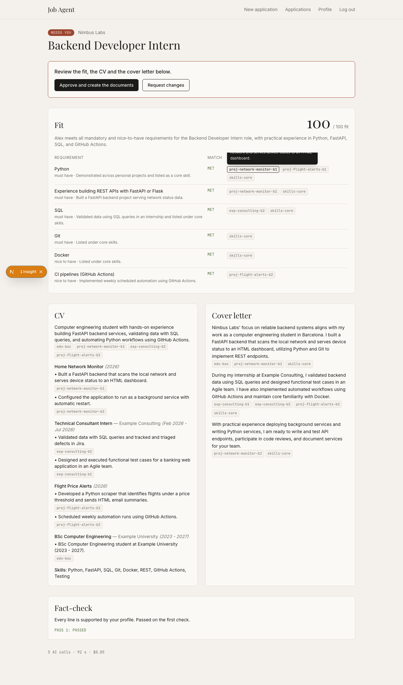

# Job Application Agent

Paste a job posting → get a fit analysis, a tailored CV and a cover letter (both `.docx`).
Every sentence is traceable to the candidate's real experience, and nothing is sent without human approval.

**Live demo:** _link after the Vercel deploy_ — replays real runs of the agent on a fictional candidate (no sign-up, no AI calls on your side).



## Why
Tailoring a CV per application takes ~30 min and it's tempting to stretch the truth.
This agent does the tailoring in about a minute and **cannot invent experience**:
it only selects, reorders and rewords items from a structured profile, and a verifier
checks every line against the evidence it cites.

## How it works

```
fetch → [unreadable?] ask to paste → extract requirements → [vague?] ask user
                             → match profile → fit score → [low fit?] ask user
                                             → tailor CV → cover letter → verify
                                               verify → [failed] regenerate only the failing document
                                                      → human approval → [edits] regenerate
                                                                       → render CV + letter .docx + log
```

- **Workflow where it's predictable, agent decisions where it isn't**: LangGraph conditional edges for unreadable URLs, vague postings, low fit, failed verification and user edits. Details and the generated graph diagram: [`docs/architecture.md`](docs/architecture.md).
- **Deterministic where possible**: the fit score and the first verification layer are plain code (tested), not LLM output.
- **Two-layer verification**:
  1. *Deterministic* (`scoring.py`, free, unit-tested): every line cites existing profile IDs; each CV bullet cites its own job/project and never borrows another one's evidence; every number appears in the cited evidence; skills exist in the profile; entries are real and unique.
  2. *LLM fact-check*: each line is checked against the evidence it cites (paraphrase OK, new facts not).
- **Untrusted input stays data**: the posting is fenced in tags it cannot close and prompts treat it as data; URL fetching blocks private/local addresses (SSRF) and oversized pages.
- **Provider-agnostic**: all LLM calls go through LiteLLM; cost and latency are recorded per step and per run.
- **Durable runs**: checkpoints in SQLite, so a run paused for your answer (or failed on a provider outage) can be resumed or retried later.

## Stack
LangGraph · FastAPI · Pydantic · LiteLLM (Gemini) · python-docx · SQLite · Next.js 16 · React 19 · TypeScript · Tailwind · Vitest · Playwright · Docker

## Run locally
Requires [uv](https://docs.astral.sh/uv/) (installs Python 3.12 for you) and Node 22+.

```bash
cp .env.example .env     # repo root: GEMINI_API_KEY, APP_PASSWORD (and SESSION_SECRET)

# terminal 1 — API
cd backend && uv sync && uv run uvicorn app.main:app --reload    # http://localhost:8000/docs

# terminal 2 — web app
cd frontend && npm install && npm run dev                         # http://localhost:3000
```
Log in with `APP_PASSWORD`. Then build your profile on the **Profile** page (guided questions → AI draft → review → save) and start an application on **New application**. Your profile, answers and runs stay on your machine (`backend/data/`, `backend/outputs/`, both gitignored).

Or with Docker: `docker compose up --build` → http://localhost:3000 (reads the same root `.env`; your profile is mounted, never baked into an image; the API is only reachable by the web app).

## Web app
| Page | What you do there |
|---|---|
| **New application** | Paste a posting or a URL; see recent runs |
| **Run** | Watch progress, answer the agent's questions, review fit + evidence (hover an ID to see your own words), CV and letter previews, fact-check history; approve or request changes; download the `.docx` files |
| **Applications** | Tracker with a status per application |
| **Profile** | Guided questions; the AI organises your answers, flags anything it couldn't find in them and asks follow-up questions; you edit and save |

The **public demo** is the same app built with `NEXT_PUBLIC_DEMO=1`: no backend, it replays runs recorded with the real agent (`backend/scripts/record_demo.py`). See [`frontend/README.md`](frontend/README.md) and [`docs/portfolio-entry.md`](docs/portfolio-entry.md).

## CLI
The whole agent in the terminal (same database as the API):
```bash
cd backend
uv run python -m app.cli run --url https://example.com/job   # or --file posting.txt / --text "..."
uv run python -m app.cli resume <run-id>                      # continue a paused or failed run
uv run python -m app.cli applications                         # tracker
```

## API
Interactive docs at `http://localhost:8000/docs`. Starting, answering and retrying return immediately; poll `GET /runs/{id}` while `status` is `running` (`409` if you answer a run that is still working). Everything except `/health` and `/auth/*` requires logging in with `APP_PASSWORD` (`POST /auth/login`), which sets an HttpOnly session cookie. Runs persist in SQLite (`backend/outputs/job_agent.db`), so they survive restarts.

| Method | Path | Purpose |
|---|---|---|
| `GET` | `/runs` | Recent runs (status, company, title, fit score) |
| `POST` | `/runs` | Start from `{"posting_url": ...}` or `{"posting_text": ...}` → `202`, runs in the background |
| `GET` | `/runs/{id}` | Current state: `status` (`running` + `step` while working), `waiting_for`, fit, CV, letter, verification, per-run LLM usage |
| `POST` | `/runs/{id}/resume` | Answer `waiting_for` with `{"value": {...}}` (shape depends on its `type`) → `202` |
| `POST` | `/runs/{id}/retry` | Re-run a step that failed (`status: "error"`, e.g. provider outage) or was interrupted by a restart → `202` |
| `GET` | `/runs/{id}/files/{cv\|cover_letter}` | Download the `.docx` |
| `GET` / `PUT` | `/profile` | The profile the agent uses (`source`: `custom` or `sample`) |
| `GET` | `/profile/questions` | Guided sections for the profile builder |
| `GET` / `PUT` | `/profile/answers` | Your saved answers |
| `POST` | `/profile/draft` | AI organises the answers into a profile draft + flags + follow-up questions (nothing saved) |
| `GET` | `/applications` | Tracker: one row per approved run |
| `PATCH` | `/applications/{id}` | `{"status": "applied" \| "interview" \| "offer" \| "rejected" \| "withdrawn"}` |

`waiting_for.type` → expected answer:

| type | when | answer |
|---|---|---|
| `paste_text` | the URL could not be read | `{"text": "..."}` |
| `clarify` | the posting is too vague | `{"answer": "..."}` |
| `low_fit` | fit score below `LOW_FIT_THRESHOLD` | `{"proceed": true \| false}` |
| `approve` | documents ready for review | `{"approved": true}` or `{"approved": false, "notes": "..."}` |

## Evals
8 hand-labelled fictional postings (English, Spanish, Catalan) against the sample profile, run with `gemini/gemini-flash-latest` on 2026-11-15. See [`evals/`](evals/).

| Extraction precision / recall | Vague posting detected | Fit score matches hand label | Unsupported lines in final documents | First draft passes verification |
|---|---|---|---|---|
| 0.89 / 0.95 | 8 / 8 | 7 / 7 | **0 / 69** | 1 / 7 (avg 2.3 verification passes) |

The verifier catches what the generator gets wrong, so nothing unsupported ships; the cost is extra passes. Making first drafts pass more often is the next optimisation.

## Design decisions
- No auto-submitting and no LinkedIn scraping (ToS). The agent prepares, the human sends.
- Real candidate data never enters the repo; a fictional sample profile is used instead.

## Development
```bash
cd backend && uv run pytest && uv run ruff check . ../evals && uv run ruff format . ../evals
cd frontend && npm run lint && npm run typecheck && npm test
cd frontend && npm run build:demo && npm run e2e      # demo smoke test (Playwright)
cd backend && uv run python -m app.agent.graph        # graph as Mermaid (docs/architecture.md)
```
No test calls an LLM or needs the backend running. CI runs all of the above on every push and PR. Changes are logged in [`CHANGELOG.md`](CHANGELOG.md).

## Roadmap
- [x] Profile, extraction, matching, deterministic fit score
- [x] CV + cover letter, two-layer verifier with targeted retries, human approval, tracker
- [x] Persistent runs (SQLite), typed API, CLI, eval harness, first Gemini eval results
- [x] Web app (password-protected) with profile builder; public demo of recorded runs
- [ ] Demo on Vercel + portfolio entry, screenshots/video
- [ ] Prompt tuning so first drafts pass verification more often (faster, cheaper runs)
- [ ] Hosted private app (Postgres/Supabase for checkpoints + tracker)
- [ ] Job discovery (Greenhouse/Lever/Ashby/InfoJobs APIs, weekly digest)

## License
[MIT](LICENSE)
