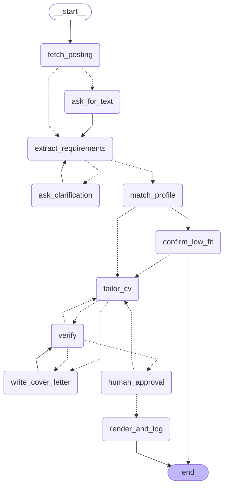

# Architecture

## Pipeline

The agent is a LangGraph state machine (`backend/app/agent/graph.py`). Solid arrows are fixed steps; dotted arrows are decisions made in code from the state (`after_*` functions). Nodes that pause for the candidate call `interrupt()`.

<!-- graph:start (generated: `cd backend && uv run python -m app.agent.graph`; checked by tests/test_docs.py) -->

<!-- graph:end -->

| Node | LLM? | What it does |
|---|---|---|
| `fetch_posting` | – | Uses pasted text, or fetches the URL safely (`app/fetch.py`). |
| `ask_for_text` | – | ⏸ `paste_text`: the URL could not be read. |
| `extract_requirements` | ✓ | Posting → `JobPosting` (requirements with must/nice, language, vagueness). |
| `ask_clarification` | – | ⏸ `clarify`: at most `MAX_CLARIFICATIONS` (2) times, then it moves on. |
| `match_profile` | ✓ | Each requirement → met / partial / gap + evidence IDs. Score computed in code. |
| `confirm_low_fit` | – | ⏸ `low_fit` when score < `LOW_FIT_THRESHOLD`. |
| `tailor_cv` | ✓ | `TailoredCV` built only from profile items, every line with `evidence_ids`. |
| `write_cover_letter` | ✓ | `CoverLetter` body paragraphs, every one with `evidence_ids`. |
| `verify` | ✓ (layer 2) | Layer 1 deterministic checks, then LLM fact-check; decides what to regenerate. |
| `human_approval` | – | ⏸ `approve`: approve, or reject with notes to regenerate. |
| `render_and_log` | – | `.docx` CV + letter into `outputs/runs/<…>/`; row in the tracker. |

## State

`AgentState` (`agent/state.py`) is checkpointed after every node. Notable fields:

- `clarifications` (append-only) and `edit_notes` (latest): trusted candidate input, kept separate from the untrusted posting.
- `verification`, `verify_attempts`, `regenerate`: drive the retry loop. Only the document with issues (`cv` / `letter`) is regenerated, and it only sees its own issues.
- `llm_calls` (append-only): every LLM call's step, model, latency, cost. Added by the `tracked()` node wrapper, reported per run by the API.

## Never inventing experience

1. **Generation is constrained by schema**: every sentence is a `GroundedLine` with `evidence_ids`.
2. **Layer 1 – deterministic** (`scoring.check_evidence_ids`, unit-tested):
   - cited IDs exist; CV entries are real, unique, entry-type items;
   - a bullet cites its own job/project and never another one's (no misattribution);
   - every number in a line appears in the cited evidence (letters may also quote the posting);
   - listed skills exist in the profile.
3. **Layer 2 – LLM fact-check** (`prompts.VERIFY`, optionally a different `VERIFIER_MODEL`): flags any claim the cited evidence doesn't support.
4. **Retry with feedback**, up to `MAX_VERIFY_RETRIES`; anything still flagged is shown to the human at approval.
5. **The human approves** before anything is rendered; nothing is ever sent automatically.

## Untrusted input

- The posting is wrapped by `prompts.fence()` in `<job_posting>` tags that it cannot close, and every prompt says that content is data, not instructions.
- `fetch.fetch_posting_text` allows http(s) only, checks every redirect hop resolves to public IPs (SSRF), and caps size (2 MB) and time (15 s).

## Persistence

One SQLite file (`DATABASE_PATH`, default `backend/outputs/job_agent.db`):
- LangGraph checkpoints (`SqliteSaver`): runs survive restarts. A failed step leaves the run at that node (`status: "error"`) and `retry` re-runs it.
- `applications` table (`tracker.py`): one row per approved run with a status pipeline.

For deployment, swap both for Postgres (Supabase): `build_persistent_graph()` and `tracker._conn()` are the only places that know about SQLite.

## Layers

```
app/cli.py ─┐
            ├─> app/runs.py (start / view / answer / retry) ─> agent/graph.py ─> agent/nodes.py ─> llm.py, scoring.py, render/, tracker.py
app/main.py ┘        └─ api/models.py (RunView: the frontend contract)
```
